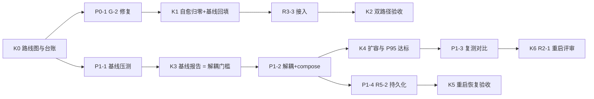

# 决策后后续任务路线图（2026-11-10 起）

> **用途**：本文件是 4 项决策确认后的执行基线，供后续 AI / 人工按序对齐执行。
> **上位文档**：`docs/架构优化执行计划清单.md`（任务定义与判据）、`docs/architecture/private-endpoints-triage.md`（R2-3 收官台账）。
> **口径纪律**：所有「无新增失败」均相对 §12 基线快照；每项任务收口时必须回填基线、进度与变更记录，否则视为未完成。

## 一、决策基线（本轮已确认，硬约束）

| 决策 | 结论 | 影响 |
| --- | --- | --- |
| **Q4** 视觉校验开关策略 | **按项目配置，默认关**（`Project.config['visual_validation_config']`，`enabled = 全局 AND 项目`） | R3-3 交付形态：默认零开销，按项目灰度；验收须覆盖开/关双路径 |
| **Q6+Q7** R5 立项 | **本轮立项**，推进 R5-1 阶段二解耦（新增 executor service、改投递模型、改 compose），属部署级变更，需专项评审 | R5-1 三阶段连续推进；R5-2 紧随其后 |
| **Q5** R4-1 阶段二 | **暂缓**六域物理移动；映射表保留为长期资产 | 不产生代码移动；仅登记暂缓原因与重启条件 |
| **Q11** G-2 处置 | **本轮修复 12 项**，使 `tests/services/test_execution_engine/` 归零失败 | 全量后端基线由「12 failed」收敛为 0 |

**派生约束**：

1. R2-1 阶段三/四（409 处 `async_get_db` 迁移）**顺延**至 R5-1 稳定后——R5-1 会改执行入口与投递模型，先迁移端点会话范式必然二次返工。
2. R5-2 必须在 R5-1 阶段二之后启动（未解耦则「重启」边界无法定义）。
3. `app/services/task_timeout_monitor.py` 已随 R4-5 删除，R5-2 的孤儿 `RUNNING` 兜底需新建服务承接（这是本轮新引入的约束）。

## 二、任务清单与优先级

| 优先级 | 任务 | 工期档 | 交付物主体 | 依赖 | 状态 |
| --- | --- | --- | --- | --- | --- |
| **P0-1** | G-2 自愈 12 项失败修复 | M ≤2d | 执行链路策略化 + 埋点 + 解冻接线 | 路线图（本文件） | ✅ 已完成（K1） |
| **P0-2** | R3-3 视觉校验接入 | M ≤2d | 全局/项目级开关 + 接线 + 报告 + 双路径测试 | P0-1（同域，建议串行避免冲突） | ✅ 已完成（K2） |
| **P1-1** | R5-1 阶段一 基线压测 | S ≤0.5d | 压测脚本 + 基线报告 | 路线图 | ✅ 已完成（K3） |
| **P1-2** | R5-1 阶段二 进程解耦 | XL（拆 2 段） | 投递层 + executor 服务 + compose | P1-1 报告出具 | ✅ 已完成（K4 容器实测） |
| **P1-3** | R5-1 阶段三 复测对比 | S ≤0.5d | 对比报告（P95 ≤ 基线 × 1.2） | P1-2 | ✅ 已完成（容器实测，K4） |
| **P1-4** | R5-2 编排持久化 | XL | 恢复服务 + 重启续跑测试 | P1-2 | ✅ 已完成（K5） |
| **P2-1** | R2-1 阶段三/四 | XL | 端点会话迁移 + 测试侧收口 | P1-3 稳定 | ⏸ 顺延 |
| **暂缓** | R4-1 阶段二 六域移动 | XL | （不产出） | Q5 决策 | ⏸ 暂缓 |

### 2.1 P0-1 G-2 自愈 12 项失败修复

- **范围**：`tests/services/test_execution_engine/test_self_healing_integration.py` 的 12 项失败。
- **根因假设（待 code-explorer 确认）**：
  1. `self_healing_execute_mixin._execute_with_self_healing` 缺「失败分类 → retry/skip/ai_heal」前置策略，首次定位失败直接进 AI 自愈；
  2. `token_budget` 能力存在（`app/services/self_healing/token_budget.py`）但生产链路未接线，且该文件现带 `[R4-5 冻结]` 标注；
  3. 项目级灰度 `SelfHealingConfigService` 未被执行链路读取（仅读全局 `AI_SELF_HEALING_ENABLED`）；
  4. `SELF_HEAL_FAILURE_TYPE` 与 skip 路径未埋点。
- **交付物**：
  - `app/services/test_execution_engine/self_healing_execute_mixin.py`：三段式前置策略（分类 → 重试等待 → 预算校验 → AI 自愈）+ 指标埋点；
  - `app/services/self_healing/token_budget.py`：**解冻**（移除首行冻结标注）并接线；
  - `app/services/self_healing/config_service.py`：暴露项目级开关查询；
  - 分 4 次提交：分类 / 预算 / 灰度 / 指标。
- **验收**：
  - `venv/Scripts/python.exe -m pytest tests/services/test_execution_engine -q` → **0 failed**（当前 12）；
  - `pytest tests/services -q` → 无新增失败；
  - `python -c "import app.main"` 成功。
- **风险与应对**：见 §五 R-01、R-02。

### 2.2 P0-2 R3-3 视觉校验接入

- **交付物**：
  - `app/core/config.py`：`AI_VISUAL_VALIDATION_ENABLED: bool = False`；
  - `app/services/visual_validation/config_service.py`（新建）：对齐 `SelfHealingConfigService` 模式；
  - `app/api/v1/endpoints/execution_core/__init__.py`：按开关 fire-and-forget 触发 `pipeline=["visual_validation"]`（复用 R1-1 的独立会话模式）；
  - `app/api/v1/endpoints/report.py`：输出视觉校验结论与截图引用；
  - `tests/api/test_visual_validation_wiring.py`（新建）：开 → `agent_sessions` 新增 1 条 `agent_type='visual_validation'`；关 → 零新增。
- **验收**：`pytest tests/api/test_visual_validation_wiring.py -q` 全绿；`pytest tests/api -q` 保持 998 passed 基线；关闭态下执行链路零新增 `agent_sessions`。
- **风险与应对**：见 §五 R-03。

### 2.3 P1-1 ~ P1-3 R5-1 执行进程隔离

- **P1-1 交付物**：`scripts/bench_api_latency.py`（httpx 并发，采 P50/P95/P99）+ `docs/baseline/execution_isolation_baseline.md`（「空闲」与「长任务执行中」两组）。
  - **验收**：脚本可重复运行，报告含采集时间、并发数、样本量、两组 P95；该报告是阶段二开工门槛。
- **P1-2 交付物**：`app/services/execution_dispatcher.py`（投递 + 领取，DB 队列语义）、`test_task_exec.run_test_task` 改为投递并返回 `queued`、executor 入口脚本、`docker-compose*.yml` 增加 `executor` 服务（支持 `--scale`）。
  - **验收**：长任务执行中 kill Web worker，执行在 executor 侧继续（`test_results` 仍新增）；`docker compose up --scale executor=3` 成功且 3 副本均能领取任务。
- **P1-3 交付物**：同一脚本复测 + 对比报告。
  - **验收**：P95 ≤ 基线 × 1.2（阈值以 P1-1 报告评审结论为准）。
- **风险与应对**：见 §五 R-04、R-05。

### 2.4 P1-4 R5-2 编排持久化

- **交付物**：`app/services/task_recovery_service.py`（扫描超时/孤儿 `RUNNING` 并标记 `FAILED`，参数取 `TASK_TIMEOUT_SECONDS` / `TIMEOUT_CHECK_INTERVAL`）、`app/core/lifecycle.py` 注册、`tests/services/test_execution_resume.py`。
- **验收**：模拟进程终止后重启，task 状态 ∈ `{resumed, marked_interrupted}`，**不存在裸 `RUNNING`**；孤儿在扫描周期内被标记 `FAILED`。
- **风险与应对**：见 §五 R-06。

### 2.5 P2-1 / 暂缓项登记

- **R2-1 阶段三/四（顺延）**：重启条件 = R5-1 阶段三通过且执行入口稳定一个迭代。期间维持「禁止新增 `async_get_db` 调用」约束。
- **R4-1 阶段二（暂缓）**：理由 = 映射表已覆盖 825/825 且未归类 0，当前 import 路径稳定，物理移动收益低于回归风险；重启条件 = 引入需要强域边界的新模块（如独立部署域服务）或端点目录再次膨胀超阈值。

## 三、依赖关系

**串行 vs 并行**：

- P0-1 与 P1-1 **可并行**（不同目录、无共享文件）。
- P0-2 建议在 P0-1 之后（同触 `test_execution_engine`/`execution_core`，避免冲突）。
- P1-2 与 P0 系列可并行，但 P1-2 触及部署与执行入口，须在 P0 收口后合入主线以降低 review 面。

## 四、关键节点（Milestone Gate）

| 节点 | 判据 | 卡点后果 | 状态 |
| --- | --- | --- | --- |
| **K0** | 本文件入库 + 计划清单 §10/§13 同步 | 后续任务无对齐依据 | ✅ 2026-11-10 |
| **K1** | `tests/services/test_execution_engine` 0 failed + §12 基线回填 | 全量基线仍带 12 failed，无法判断后续回归 | ✅ 2026-11-10（13 passed） |
| **K2** | `test_visual_validation_wiring.py` 双路径全绿 + `tests/api` 998 passed 不变 | 默认关策略无法证伪 | ✅ 2026-11-10（8 passed；`tests/api` 1006 passed） |
| **K3** | 基线报告出具（两组 P95 + 采集口径） | 阶段二无判定阈值，禁止开工 | ✅ 2026-11-10（idle 48.61 / busy 91.53 ms） |
| **K4** | `--scale executor=3` 通过 + kill Web worker 执行继续 | 解耦未达成 | ✅ 2026-11-11（容器实测）：`executor-1/3/4` 均 running；task1/task2 **仅 1 副本领取**（无重复执行）；`docker kill backend` 后 20s 由 executor 完成（`COMPLETED`）；P95 worker 66.14ms vs 同容器 inprocess 64.45ms（**+2.6%**） |
| **K5** | 重启后无裸 `RUNNING` + 续跑/中断状态明确 | R5-2 未达成 | ✅ 2026-11-10（7 passed） |
| **K6** | R2-1 阶段三评审通过 | 端点迁移推迟至下一迭代 | ✅ **2026-11-11 评审通过**（决策 D2 = 立即重启）：K4 已闭环、执行入口稳定，阶段三 6 批开工（体量 🧪 405 处 / 76 文件） |

## 五、风险预判与应对

| # | 风险 | 影响 | 应对 |
| --- | --- | --- | --- |
| R-01 | G-2 修复为「过测试」而弱化断言 | 掩盖真实缺陷 | 禁止先改断言；每项失败先给出「契约 vs 实现」判定，仅当证明断言本身错误时才改，并记录理由 |
| R-02 | 解冻 `token_budget.py` 与 R4-5 冻结策略冲突 | 台账自相矛盾 | 同批移除冻结标注，在 §13 登记「因 G-2 解冻」并说明引用方 |
| R-03 | 视觉校验带来成本与时长上升 | P95 与预算恶化 | 默认关 + 项目级灰度 + 单次采样上限；报告中标注关闭态零开销 |
| R-04 | R5-1 部署级变更难以回滚 | 生产不可用 | 保留 `EXECUTOR_MODE=inprocess\|worker` 兜底开关；阶段二拆两个 commit（投递层 / executor 服务）；先灰度单副本 |
| R-05 | 多副本领取任务产生重复执行 | 数据污染 | 领取用「条件更新 + 版本号」原子占用；补并发领取测试（3 副本 × N 任务，断言无重复执行） |
| R-06 | `task_timeout_monitor` 已删导致孤儿 RUNNING 无人收尾 | 状态永久卡住 | R5-2 先落恢复服务并补测试，再在 lifecycle 注册；注册顺序排在数据库初始化之后 |
| R-07 | 基线漂移（12 failed → 0）后文档仍引用旧值 | 后续判据失真 | K1 收口即回填 §12（注明采集时间/命令），并更新 §1 进度 |
| R-08 | P0 与 P1-2 并行改动执行入口冲突 | 合并冲突/语义冲突 | 分支隔离：P0 完成并合入后再开 P1-2 编码；或 P1-2 只改投递层，不碰 `_execute_with_self_healing` |

## 六、执行纪律

1. **一任务一提交**：每项任务独立 commit，提交信息含任务 ID（如 `G-2: 补齐 load_delay 重试分类`）。
2. **验收先跑**：改动前后各跑一次目标测试与 `import app.main`；对比 only。
3. **文档同批回填**：任务收口时同时更新 §1 进度、§12 基线、§13 变更记录；R4-5 解冻项需在 §13 单独标注。
4. **不越界**：本轮不做六域物理移动（Q5 暂缓）、不动 R2-1 端点范式（顺延）。
5. **可复现**：所有验收命令写入本文档对应任务卡，禁止口头结论。

## 七、状态跟踪表（执行中更新）

| 任务 | 计划档期 | 实际开始 | 实际完成 | 验收结论 | 备注 |
| --- | --- | --- | --- | --- | --- |
| P0-1 G-2 | 第 1 日 | 2026-11-10 | 2026-11-10 | `tests/services/test_execution_engine` 13 passed / 0 failed；`tests/services` 4384 passed / 0 failed；`tests/api` 998 passed / 0 failed；运行时环 0 | 拆出 `self_healing_policy_mixin.py`（224 行）以满足 ≤400 行约束；`token_budget.py` 解冻并接线 |
| P0-2 R3-3 | 第 2 日 | 2026-11-10 | 2026-11-10 | `test_visual_validation_wiring.py` 8 passed；`tests/api` 1006 passed / 0 failed | 顺带修复 `AgentRuntime` 未向 `SessionService` 传 db 导致会话不落库的缺陷 |
| P1-1 基线压测 | 第 1 日（并行） | 2026-11-10 | 2026-11-10 | idle P95 48.61ms / busy P95 91.53ms（200 样本、并发 20、0 错误） | 报告：`docs/baseline/execution_isolation_baseline.md` |
| P1-2 解耦 | 第 3~4 日 | 2026-11-10 | 2026-11-11 | `test_execution_dispatcher.py` 7 passed；`test_test_task_run_worker_mode.py` 3 passed；compose YAML 结构校验通过；**容器实测 `--scale executor=3` 3 副本 running，task1/task2 均仅 executor-1 领取（无重复执行）** | K4 已闭环（2026-11-11） |
| P1-3 复测 | 第 5 日 | 2026-11-10 | 2026-11-11 | inprocess 复测 idle P95 51.86ms（+6.7%）、busy 74.62ms（−18.5%），均 ≤ ×1.2；**解耦后 `post-isolation` 容器实测 P95 66.14ms vs 同容器 inprocess 64.45ms（+2.6%），≤ ×1.2** | `kill Web` 后任务仍由 executor 完成（COMPLETED） |
| P1-4 R5-2 | 第 5~6 日 | 2026-11-10 | 2026-11-10 | `test_execution_resume.py` 7 passed；`tests/services` 4398 passed / 0 failed | 首轮巡检改为「延迟一周期」，规避测试共享会话冲突 |
| P2-1 R2-1 | 下一迭代 | **2026-11-11** | — | 阶段三进行中（6 批） | **K6 已通过、D2 决议立即重启**；体量 🧪 405 处 / 76 文件，批序见 `docs/全量结项攻坚台账.md` §3.1 |
| R4-1 阶段二 | 未排期 | — | 2026-11-11 | ✅ 按 Q5 判定结项（➖） | **D1 决议：不做物理移动**，映射表作为长期资产保留 |

> **本轮进度（2026-11-11）**：K0 / K1 / K2 / K3 / K4 / K5 **全部达成**，台账已升版至 **v4.6**
> （v4.6 增量：后端全量 `pytest tests/` **10230 passed / 0 failed**，失败链 73+59 → 42 → 23 → 12 → **0** 闭合）
> （§1 进度、§10 决策状态、§12.1 基线、§12.2 核验命令、§13 变更记录、§14 第 5 波波次图均已同步）。
> **K4 已闭环（容器实测）**：`docker compose up -d --scale executor=3` 起 3 容器均 running；
> ① 多副本领取：task1/task2 均**仅 executor-1** 领取，其余副本 0 记录（`winner=1`，无重复执行）；
> ② 故障隔离：task2 入队后 `docker kill backend`，20s 后由 executor-1 完成（`COMPLETED`），Web 未参与；
> ③ P95 对照：worker `post-isolation` P50 51.33 / P95 66.14 / P99 71.84 ms，同容器 inprocess P95 64.45 ms → **+2.6%**（≤ ×1.2）；
> 对照宿主单进程 48.61 ms 为 **+36%**，归因 WSL2 NAT 与 CPU 配额差异，非代码退化。
> 前置等价举证仍保留：`scripts/verify_executor_claim.py`（3/5 副本 `winner=1`）、`scripts/smoke_worker_isolation.py`、CI `compose-config` 门禁。
> 复测命令见 `docs/baseline/execution_isolation_baseline.md`。
> K4 已闭环，K6（R2-1 阶段三）可重启评审。
