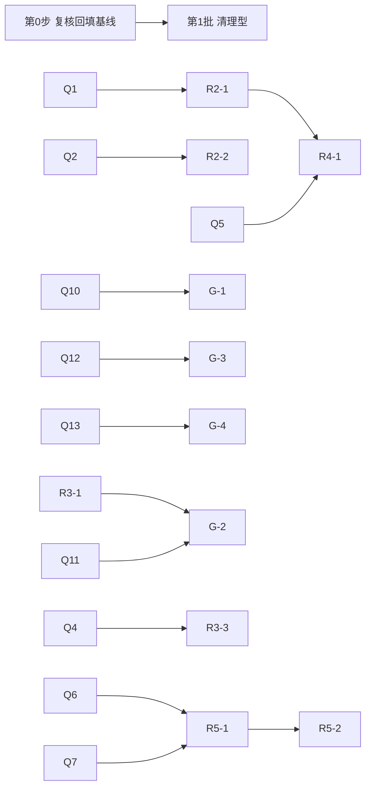

# 优化清单 v1.8 进度审查报告

- **审查日期**：2026-11-09
- **审查对象**：`docs/架构优化执行计划清单.md`（v1.8，985 行，最新提交 `cc32c4e`）
- **审查方式**：清单核对 + 后端全量/前端单测实测 + 代码现状核查（code-explorer）+ 关键符号二次确认
- **口径**：🧪 = 本轮实跑；📋 = 未复跑的历史快照；⏱ = 工期档（S≤0.5 / M≤2 / L≤5 / XL 需拆分）

---

## 一、进度总览

| 维度 | 数值 |
| --- | --- |
| 任务总数 | 34 项（含 1 项废弃 D-3）→ 33 项可执行 |
| ✅ 已完成 | **18** 项 |
| ⬜ 未开始 | **15** 项 |
| ➖ 已废弃 | 1 项 |
| 里程碑 | M0 ✅、M1 ✅、M2 ✅（2026-09-24）、**M3 ⬜、M4 ⬜、M5 ⬜** |

| 任务组 | 完成度 | 状态 |
| --- | --- | --- |
| A 文档基线 | 5/5 | ✅（M0） |
| R0 卫生收口 | 4/4 | ✅（M1） |
| R1 能力接线 | 3/3 | ✅（M2） |
| R2 结构归一 | 0/3 | ⬜ |
| R3 智能层 | 0/3 | ⬜ |
| R4 模块治理 | 1/4 | 🔄 仅 R4-4 |
| R5 执行演进 | 1/3 | 🔄 仅 R5-3 |
| D 安全治本 | 3/3（+1 废弃） | ✅ |
| G 遗留欠账 | 1/5 | 🔄 仅 G-5 |

---

## 二、已圆满完成项及验证结果

| 项 | 内容 | 验证结果（采集日期 / 标记） |
| --- | --- | --- |
| A-1~A-5 | 架构设计规范 / 数据模型字典 / API 契约 / 前端指南 / 遗留清单 | 文档落盘（📋 2026-09-18） |
| R0-1 | 仓库卫生（216MB 清理、.gitignore/.gitattributes） | 无跟踪残留（📋） |
| R0-2 | Celery 残留冻结 | `tests/tasks` **53 collected**（🧪 2026-09-18） |
| R0-3 | 项目归属校验归一 | `_verify_task_access` 0 处（🧪）；`_verify_project_access` 仍有 `_history_asset_helpers.py` 平行实现（O-4b） |
| R0-4 | Cypress→Playwright | cypress 引用 **0**、YAML 合法、`vue-tsc` 退出 0（🧪 2026-09-22） |
| R1-1 | fire-and-forget 失败分析（Q3=失败分析） | **4 passed**（🧪 2026-09-24） |
| R1-2 | `POST /agents/sessions/run` | **7 passed**（🧪） |
| R1-3 | `GET audits` + 前端监控页 | **4 passed** + `vue-tsc` 零输出 + vitest 555/555（🧪） |
| R4-4 | SAML/OIDC/MFA `importorskip` 兜底 | 5 文件 **39 passed / 3 skipped / 0 failed**（🧪 2026-09-24） |
| R5-3 | PR 门禁分层（排除清单 + 注释） | YAML `safe_load` 通过、cypress 0（🧪）；遗留 Branch protection 人工配置 |
| D-1 | 提示词注入防护 | ✅ |
| D-2 | JWT 轮换 / PII 脱敏 / 安全响应头 | ✅ |
| D-4 | `health:deep` 监控 | ✅ |
| G-5 | 16 spec / 168 用例按规格恢复 | **37 文件 37 passed、555 用例 555 passed**（🧪 2026-11-09，两次独立复跑） |

**遗漏登记闭环**：O-1~O-3、O-5~O-11（🧪 历史）；O-12 ✅（诊断 63+59 清零）；O-13 ✅（`test_ab_test_api` 17 passed）；O-15 ✅；O-20 ✅（=G-5）。

---

## 三、本轮基线实测（2026-11-09）

### 3.1 后端全量

命令：`venv\Scripts\python.exe -m pytest tests -q --no-header -p no:cacheprovider`

> 🧪 **42 failed / 10114 passed / 153 skipped / 199 deselected / 79 warnings（1074.27s）**

对比：基线 73 failed + **59 errors** → 本轮 **42 failed + 0 error**，**collection/装置错误已归零**，passed 由 10191 → 10114（失败集变化所致）。

### 3.2 42 个失败按文件归组

| 文件 | 数量 | 归属 |
| --- | --- | --- |
| `tests/services/test_execution_engine/test_self_healing_integration.py` | 12 | G-2 / O-17 |
| `tests/services/test_audit_chain_service.py` | 11 | G-1 / O-16 |
| `tests/test_health_probes.py` | 7 | **未登记（新）** |
| `tests/test_core_config_prod_security.py` | 5 | **回归（清单称 2026-09-24 已通过）** |
| `tests/utils/test_report_utils.py` | 4 | **回归（原计入 O-12「报表依赖」）** |
| `tests/services/agent/test_orchestrator_wiring.py` | 1 | **未登记（新）** |
| `tests/test_core_config.py` | 1 | **未登记（新）** |
| `tests/test_models_user.py::TestTaskStatus::test_labels_completeness` | 1 | **新（疑似 PAUSED=5 未进 labels）** |

### 3.3 前端单测（异常）

命令：`node node_modules/vitest/vitest.mjs run --reporter=basic` 与 `npx vitest run` 结果一致：

> 🧪 **37 files failed / no tests**（`Error: No test suite found in file ...` ×37，11.89s）

**判定**：这是**环境/依赖异常**（典型症状为存在两份 `vitest` 实例或 `setupFiles` 未生效），**不是用例断言失败**；与清单同日 G-5 收官 **555/555** 冲突。需 `npm ci` 重装后复跑确认，登记为 **O-21**。

### 3.4 前端类型检查

`npx vue-tsc --noEmit`：本轮命令被工具中断，**未复跑**（📋 沿用 2026-09-22 零输出结论），列入待复跑。

---

## 四、失败集「位移」与清单映射

相较 2026-09-24 的 O-14 五项，本轮出现明显位移：

| O-14 子项 | 2026-09-24 | 2026-11-09 | 结论 |
| --- | --- | --- | --- |
| ① 租户隔离（Tenant） | ~13 error | **0** | ✅ 已转绿（tenant_id 恢复） |
| ② 审计哈希链 | 11 failed | **11 failed** | ❌ G-1 未完成 |
| ③ 自愈集成 | 12 failed | **12 failed** | ❌ G-2 未完成 |
| ④ 依赖解析 | 2 failed | **0** | ✅ 已转绿（`dependency_resolution_mixin/` 已实现） |
| ⑤ legacy 套件 | ~40 error | **0（smoke_api 已绿）** | ✅ 基本转绿 |

同时**新增/回归 19 项**（health_probes 7、prod_security 5、report_utils 4、orchestrator_wiring 1、core_config 1、models_user labels 1），不在既有 O-14 目录，登记为 **O-22**，需逐项归因（疑似与密钥/配置环境、健康探针路由、报表依赖、`TaskStatus.PAUSED=5` 相关）。

---

## 五、未完成项逐项（15 项，含代码现状核查）

> 现状来自 code-explorer 只读核查（文件/行号级证据）；"剩余工作"为达成清单判据所需。

| 编号 | 现状（证据） | 剩余工作 | 依赖/决策 | ⏱ |
| --- | --- | --- | --- | --- |
| R2-1 | 会话工厂集中在 `app/db/database/_engine.py`（`sessionmaker` :123/:170、`async_sessionmaker` :250/:286、`create_async_engine` :230 调用 :243）；`async_get_db` 定义 `_session.py:93`，**88 个端点文件**仍引用 | 统一为单范式 + `to_thread`；压降端点直连（88→0）；4 阶段收口 | Q1 | XL |
| R2-2 | `require_master` 定义 `app/db/router.py:90`，**0 处 `Depends` 业务调用**；`routing_sessionmaker` **0 命中**；读写入口在 `router.py`，引擎 `_engine.py:243/:264` | 按 Q2 删除零使用点；读写分离降级为「配置预留」 | Q2 | M |
| R2-3 | `test_case_view_service.py` 仅 re-export，实现在 `test_case_view/`（11 文件）；`test_case_export.py` 仍自带 4 个 helper（:36/:42/:51/:100）；`report.py` 导出在端点内组装（:179–244）；test_case↔plan 回填**当前不存在** | 下沉 view/导出/回填到 service；端点私有实现文件 17→≤10 | — | L |
| R3-1 | **已存在** `app/services/self_healing/`（failure_analyzer / metrics / config_service / audit_service / models / token_budget）+ 策略 mixin | 策略权重外置 + 指标化 + 灰度对齐（与 G-2 划清边界） | Q8 | M |
| R3-2 | `app/pipelines/steps/decision_dispatch/_step.py` **8 个 `elif action`** 硬编码（:114–:190），`ai_confidence=30` 硬编码（:217） | 8 分支改规则表驱动 + 阈值外置 | — | M |
| R3-3 | `visual_ai` 仅被自身包 + API 层引用，`test_execution_engine/` 下 0 命中 | 接入执行主链路 + 按项目开关 | R1-1 ✅ + Q4 | M |
| R4-1 | `app/services/` 二级子包 **40 个**；`endpoints/` 顶层 `_` 私有文件 **17 个** | 六域映射表 → 6 批移动 + shim 一迭代 | R2-1 + Q5 | XL |
| R4-2 | `app/main.py` `lifespan` L51–106 **约 56 行**（内含 init_db / 默认管理员 / APScheduler） | 拆出独立生命周期模块，主函数 ≤15 行 | — | M |
| R4-3 | `usage_stat/telemetry/track_event/使用率` **0 命中**（仅 Prometheus / A-B 指标） | 使用率埋点 + 报表 | 需可观测数据 | M |
| R5-1 | Celery 已冻结于 `app/tasks/_frozen/`；`main.py` 无 celery；无独立 worker 进程 | 独立容器化 worker（3 阶段） | Q6 + Q7 | XL |
| R5-2 | **已有**暂停/恢复持久化：`app/pipelines/runner.py:87–116` 依据 `pause_payload["step_name"]` 续跑 | 补齐持久化队列 + 一致性/恢复边界 | R5-1 + Q7 | XL |
| G-1 | `compute_record_hash` **不存在**；`verify_chain_integrity` 已实现但 `audit_chain_service.py:142` 调 `record.compute_hash(...)`，而 `audit_log.py` 无该方法 → 运行期 `AttributeError`；且无生产调用点 | 在模型/服务实现 `compute_record_hash` + 生产接线；11 failed 转绿 | Q10 | M |
| G-2 | 自愈集成**已接线**（`self_healing_*_mixin.py` 5 文件）；12 failed 为行为断言 | 与 R3-1 策略/指标对齐后转绿 | R3-1 + Q11 | M |
| G-3 | **已实现** `dependency_resolution_mixin/`（graph/navigation/orchestration/snapshot） | 提供可选开关 + 2 failed 转绿 | Q12 | S |
| G-4 | 4 套件均存在、**均非契约式**（`code==200` 宽松断言 / 条件跳过 / unittest 直连 DB） | 重写为契约测试（状态码 + 关键字段） | Q13 | M |

**补充**：`app/services/` 下**无 >400 行文件**（最大 `visual_ai/baseline_service.py` 377 行），行数规范已达。

---

## 六、决策阻塞（12 项，均有推荐默认 + 最晚时点）

| 编号 | 事项 | 关联 | 最晚时点 | 推荐默认 |
| --- | --- | --- | --- | --- |
| Q9 | PR CI 门禁严格度 | R5-3 | 随时 | 必阻断 = ruff+tsc+pytest+vitest |
| Q1 | 范式 + `async def` 处置 | R2-1 | 第 2 波前 | 全 sync + `to_thread` |
| Q2 | `require_master` | R2-2 | 第 2 波前 | 删除 |
| Q5 | import 全量变更 | R4-1 | 第 2 波前 | 分阶段（映射表→6 批+shim） |
| Q10 | 审计哈希链 | G-1 | 第 2 波前 | 补全 |
| Q12 | 依赖解析 | G-3 | 第 2 波前 | 可选能力 |
| Q13 | legacy 套件 | G-4 | 第 2 波前 | 改契约测试 |
| Q4 | 视觉开关 | R3-3 | 第 3 波前 | 按项目配置（默认关） |
| Q8 | 自愈学习 | R3-1 | 第 3 波前 | 统计驱动 |
| Q11 | 自愈随 R3-1 | G-2 | 第 3 波前 | 随 R3-1 |
| Q6 | 部署形态 | R5-1 | 第 4 波前 | 独立容器 |
| Q7 | R5 独立立项 | R5-1/R5-2 | 第 4 波前 | 是 |

> Q3、Q14 已决策/已执行。

---

## 七、本轮新发现风险

- **O-21 前端单测环境异常**：37/37 spec「No test suite found」→ 疑似重复 vitest 实例 / setupFiles 失效。处置：`npm ci` 后以 `node node_modules/vitest/vitest.mjs run --reporter=basic` 复跑，确认是否恢复到 555/555。
- **O-22 新增/回归失败 19 项**：health_probes(7)、prod_security(5)、report_utils(4)、orchestrator_wiring(1)、core_config(1)、models_user labels(1)。需逐项归因（配置/密钥环境、健康探针路由、报表依赖、`TaskStatus.PAUSED=5` 未进 labels）。
- **口径缺口**：§12.1 后端全量基线尚未回填本轮 42/10114；`vue-tsc` 本轮未复跑。

---

## 八、分批推进路线

- **第 0 步（立即）**：修复 O-21（`npm ci` 复跑前端）+ 归因 O-22 六类失败 + 回填 §12.1。
- **第 1 批（无需决策）**：G-3、G-4、R4-2、R4-3。
- **第 2 批（Q1/Q2/Q5/Q10/Q12/Q13）**：R2-1/R2-2 + G-1 + G-3/G-4 → R2-3 → R4-1。
- **第 3 批（Q4/Q8/Q11）**：R3-1/R3-2/R3-3 + G-2。
- **第 4 批（Q6/Q7，独立立项）**：R5-1/R5-2。
- **横切**：O-19 循环依赖、O-4/O-4b 语义统一，随 R2-1/R4-1 顺手处理。

---

## 九、结论

1. **已完成 18 项均具备可复核证据**；前端 G-5 已于同日闭环（555/555）。
2. **后端失败由 73 failed+59 errors 降至 42 failed+0 error**，装置错误清零，O-14 的「租户隔离 / 依赖解析 / legacy 套件」三项已转绿。
3. **剩余阻塞集中在 G-1（审计哈希链，代码层缺 `compute_record_hash`）与 G-2（自愈集成）**，另有 19 项新增/回归失败（O-22）与前端环境异常（O-21）需优先归因。
4. **所有未完成项均可被 12 个决策中的推荐默认值解锁**，不存在无限期阻塞项。
